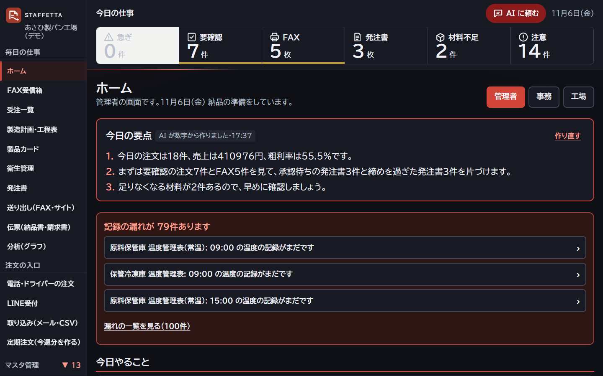
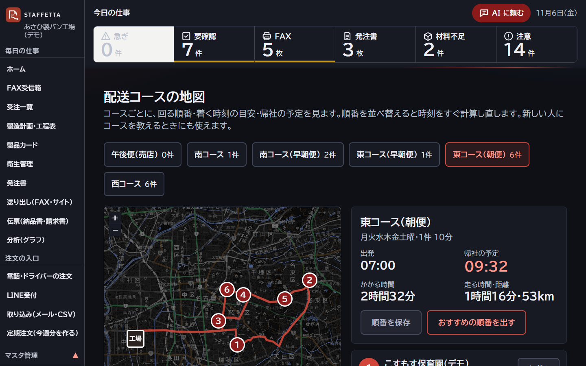
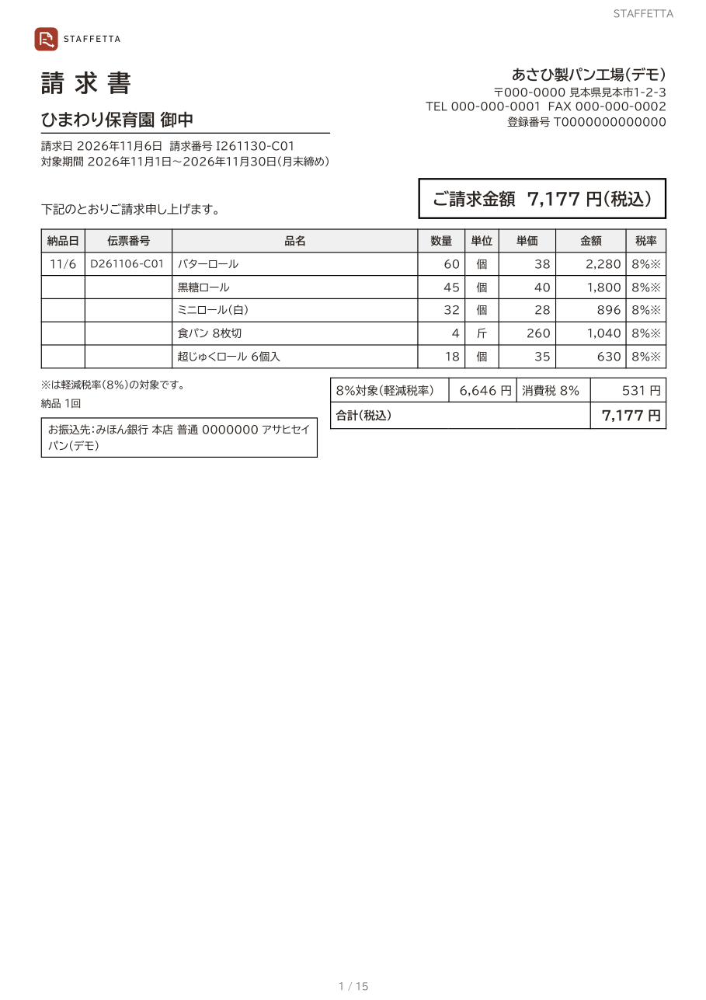
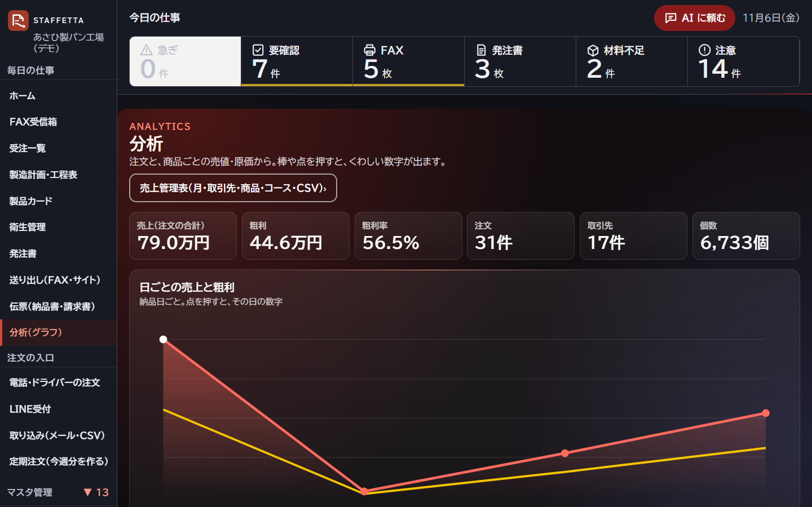
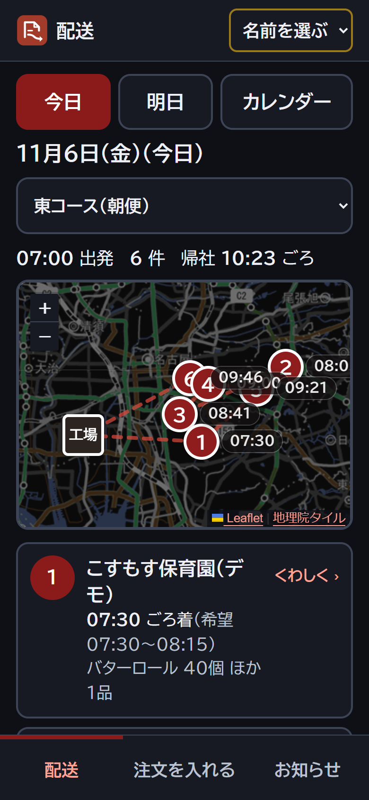
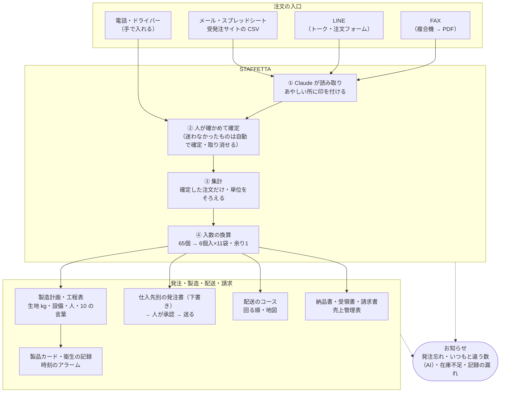

# STAFFETTA（スタフェッタ）


STAFFETTA（スタフェッタ）はイタリア語で「リレー」。ばらばらに届く注文を次の工程へ、ベテランしか知らない仕事を次の人へ、バトンのようにつなぐ、中小の食品工場の受発注アプリです。

FAX・LINE・メール・スプレッドシート・受発注サイト・電話から届くパンとピザの注文を1か所に集め、
**集計 → 入数の換算 → 仕入先別の発注書 → 製造計画・工程表 → 材料の発注 → 製品カード・衛生の記録 → 配送のコース → 納品書・請求書** まで、ひと続きで出します。

> ハッカソン「Built with Claude: Japan 2026」の応募作品です。リポジトリ: https://github.com/cameliya-tomoiida/staffetta
> データ（得意先・仕入先・商品・単価・レシピ）は、すべて架空のものです。写真もすべて架空のデモのデータで撮りました。
> **このリポジトリのコードは、すべてハッカソン期間中に新しく作りました（最初のコミットは 2026-11-04 21:04）。** 前からあったのは、工場の複合機が FAX を PDF にして Gmail へ転送する設定だけです。

## ひと目で

<table>
  <tr>
    <td width="50%"><b>FAX を Claude が読んで、迷った所だけ人が見る</b><br></td>
    <td width="50%"><b>役割ごとのホームと「AI に頼む」</b><br></td>
  </tr>
  <tr>
    <td><b>作る数・始める時刻・人が足りるかを1画面で（10 の言葉）</b><br></td>
    <td><b>配送のコースを見直して、地図で順に決まっていく</b><br></td>
  </tr>
  <tr>
    <td><b>納品書・請求書（インボイスの書き方）を、確定した注文から</b><br></td>
    <td><b>売上・粗利を動くグラフで（司令室）</b><br></td>
  </tr>
  <tr>
    <td><b>お客さんは LINE で、届け日と数を押すだけ</b><br></td>
    <td><b>配送の人はスマホで、回る順・いつもの品・その場の注文</b><br></td>
  </tr>
</table>

## 誰の、何を解決するか

愛知の中小のパン・ピザ工場（従業員 数十人）の実際の困りごとから作りました。

| 誰が | いま困っていること | STAFFETTA で |
|---|---|---|
| 事務の人（60代） | 毎晩、FAX・電話の注文を紙に書き写し、電卓で入数を換算して、仕入先ごとに発注している。FAX は逆さま・横向き・手書きの訂正つきで届き、「1と7」を読み違える | Claude が FAX を読み、迷った行だけ黄色。人は元の FAX と見比べて、タップとテンキーで確定するだけ。発注書は自動で下書き |
| 工場の責任者 | その日になって生地の量・材料・人の数を計算し直す。外国人スタッフに工程を伝えにくい。衛生の記録の漏れを視察で指摘される | 確定した注文から製造計画・工程表（設備と人の制約つき）を自動で。10 の言葉に1タップ。製品カードと衛生の記録をタブレットで、時刻が来たらアラーム |
| 配送の人 | 回る順・その店の置き場所・いつもの品が頭の中にしかない | スマホで回る順・地図・納品の仕方。その場の追加注文も入れられる（電波が無くても後で送る） |
| お客さん（保育園・病院・飲食店） | FAX を書いて送るのが手間 | LINE で届け日と数を押すだけ |
| 経営 | 取引先・商品ごとの売上と粗利が月末まで分からない | 売上管理表と動くグラフ。伝票（納品書・受領書・請求書）まで出して、事務の手間をなくす |

画面を使うのは、高齢の事務員さんと外国人スタッフです。そのため、少ない画面・大きな文字と押しやすいボタン・やさしい日本語・10 の言葉にしています。スマホ・タブレット・パソコンのどれでも使えます。

## 注文の入口と流れ



- 変更・キャンセルの連絡は、新しい注文（`intent: change / cancel`）として入れます。人が確定するまで、元の注文は書き換えません。
- 仮発注（概数で先に来て、当日に確定する注文）は集計に入れず、「仮：○個」として別枠で見せます。

## 画面

| 画面 | 内容 |
|---|---|
| `/home` | 役割ごとのホーム（管理者・事務・工場）。今日やること、管理者には AI の「今日の要点」 |
| `/` ・ `/fax/[id]` | FAX 受信箱と確認画面。元の FAX と読み取り結果を並べ、迷った行だけ見比べて確定 |
| `/orders` | 受注一覧。すべての入口の注文を1つに（要確認・仮発注・変更・取消の印つき） |
| `/plan` | 製造計画・工程表。生地 kg・時刻・設備と人の制約・材料・原価。10 の言葉で印刷 |
| `/cards` ・ `/hygiene` | 製品カード（生地ごとの工程の記録）と衛生管理のシート。記録の時刻のアラームと漏れの一覧 |
| `/purchase` ・ `/outbound` | 仕入先×便ごとの発注書の下書き → 承認 → 発注の送信（受発注サイト・FAX・メール） |
| `/admin/routes` ・ `/driver` | 配送のコースの見直し（地図）と、配送の人のスマホの画面 |
| `/slips` | 伝票（納品書・受領書・請求書）と売上管理表（CSV） |
| `/analytics` | 売上・粗利・取引先・商品の動くグラフ |
| `/alerts` | お知らせ（急ぐ順。担当に回す・あとで・済み） |
| `/line` ・ `/liff/order` | LINE 受付（スタッフ用）と、お客さんの LINE の注文フォーム |
| `/masters/*` ・ `/settings/*` | マスタ（商品・レシピと工程・取引先・仕入先・材料・設備と人・便）と設定（スタッフとログイン・機能の ON/OFF・AI・休業日・自社の情報） |
| 右上の「AI に頼む」 | 「来週月曜、ひまわり保育園にバターロール 50個追加」のように頼むと、Claude が探して要確認の注文を入れる。登録などは OK を押すまでしない |

もっと多くの画面写真は [docs/screenshots/](docs/screenshots/) にあります（スマホ・タブレット・印刷）。

## 使い方の手引き

- [スタッフ向けの操作の手引き](docs/manual/README.md) — 1日の流れと、マスタの登録
- [お客さん向け「LINE でのご注文のしかた」](docs/manual/customer-line-order.html)（A4 1枚・[PDF](docs/manual/customer-line-order.pdf)）
- [導入のしかた](docs/manual/setup.md) — マスタの CSV → FAX の転送 → LINE → 1週間ためて様式を承認

## 動かし方

Node.js 20.9 以上が必要です（動作確認は 24）。保存は Node の組み込みの SQLite（`node:sqlite`）で、データベースのサーバーは要りません。

```bash
git clone https://github.com/cameliya-tomoiida/staffetta.git
cd staffetta
npm install
```

`.env.example` を `.env.local` という名前でコピーし、次の項目に値を入れます。
空の項目があっても動きます。LINE が空ならデモモードになり、送らずに記録だけ残します。

| 項目 | 用途 |
|---|---|
| `ANTHROPIC_API_KEY` | Claude で FAX・メールなどを読み取る（画面の「設定 → AI」でも入れられる） |
| `FAX_INBOUND_TOKEN` | Gmail（GAS）から FAX を受け取るときの合言葉 |
| `LINE_CHANNEL_SECRET` / `LINE_CHANNEL_ACCESS_TOKEN` | LINE 公式アカウント（Messaging API） |
| `LINE_LOGIN_CHANNEL_ID` / `NEXT_PUBLIC_LIFF_ID` | LINE の注文フォーム（LIFF） |
| `MS_CLIENT_ID` / `MS_CLIENT_SECRET` / `MS_TENANT_ID` | メール送信（Microsoft Graph。「設定 → メール送信」の「Microsoft でつなぐ」で使う。パスワードは入れない） |

```bash
npm run dev -- -p 3100   # 開発サーバー（http://localhost:3100）
npm run build && npx next start -p 3100   # 本番モード（ふだんはこちら）
npm test                 # テスト（vitest・674件）
npm run demo:reset       # デモを最初の状態に戻す
npm run fax:simulate     # 「FAX が届いた」を再現する（変更 → 仮発注 → 本発注の FAX を1枚ずつ）
LINE_TEST_URL=http://localhost:3100/api/line/webhook node scripts/line-webhook-test.mjs "明日 ロール 20個"
                         # LINE の注文を再現する（LINE 未設定でも可）
```

**使い始める前に、必ず「設定 → スタッフの登録」で管理者のパスワードを作ってください。** パスワードのある管理者が1人もいない間は、ログインなしで全部の画面が動き、社内の LAN の誰でも全部の操作ができます。`next start` は LAN のほかの PC からも使うので全部の宛先（0.0.0.0）で待ちます。3100 番は Windows のファイアウォールで社内の LAN の中だけに開けてください（外からは下の「外からの入口」の2つだけ。どちらも localhost に向けるので、ほかのネットワークには開けなくてよい）。作ると、役割（管理者・事務・工場・配送）ごとのログインになります。管理者がいない間は、設定の画面に黄色の1行「ログインを使い始めるまで、社内専用です」が出ます。バックアップのファイルには、AI のキー・メールのつなぎ・パスワードの印は入りません。
### 外からの入口

| 入口 | 使う所 | URL |
|---|---|---|
| Tailscale Funnel（固定 URL `https://<PC の名前>.<tailnet>.ts.net`） | LINE の注文フォーム（LIFF）・スタッフのログイン・外からの画面 | 変わらない。`.env.local` の `HUB_PUBLIC_URL` に書く |
| cloudflared の quick tunnel（`https://xxxx.trycloudflare.com`） | LINE の Webhook だけ（LINE は Funnel の証明書と TLS の交渉ができないため） | 起動のたびに変わる → 自動で LINE に登録し直す |

- 起動は `scripts/start-3100.ps1`（cloudflared → 3100 → 30秒待って `scripts/line-webhook-sync.mjs`）。PC を立ち上げたときに自動で動かすには、`scripts/register-startup-task.ps1` を1回だけ実行して、Windows のタスク スケジューラ（ログオン時）に登録します。
- `line-webhook-sync.mjs` は、cloudflared の管理口（`127.0.0.1:20241`〜`20245` の `/quicktunnel`）から今の URL を読み、LINE に登録してある URL と違えば付け替えて、LINE からの確かめ（webhook/test）まで行います。結果は `data/line-webhook-sync.log`。付け替えたらお知らせ（info）、失敗したらお知らせ（danger）が1件出ます。`--dry-run` で、何も変えずに今の URL だけ見られます。
- 外から来たアクセスは、どちらの入口でも見分けます（`src/lib/tunnel-access.ts` の `fromOutside`）。全データの書き出し・戻し（`/api/backup`・`/settings/backup`）は、ログインしていても外からは使えません。

接続の手順は `docs/` にあります（`line-setup.md`・`gmail-setup.md`・`google-sheet-auth.md`・`fax-sending.md`・`tunnel.md`・`prod-3100.md`）。

## これから

目標は、**会社のすべての仕組みと管理を、これ1つで回すこと**です。

1. **第1段：弥生販売の代わり** … 入金の消し込み・売掛・買掛・在庫・得意先元帳（伝票・請求書・売上管理表・弥生の CSV はもうある）
2. **第2段：シフト** … 製造計画の「人が足りない時間」から、班と人を組む
3. **第3段：給与・会計** … はじめは弥生会計・freee へのつなぎから

## 設計の決まり

- **AI がするのは「読み取り」と「要確認の印付け」まで。** 値を直すのも、確定するのも人です。人が確定した値を、AI が上書きすることはありません。
- **元の値と修正の履歴を必ず残します。** AI が読んだ値（`read`）と、誰が・いつ・何を・何から何に直したか（`edits`）を保存します。
- **発注書・請求書は「下書き → 人が確かめる → 送る」の順だけ。** 承認していない発注書は送れません。
- **計算はふつうのプログラム（純関数）で行います。** 集計・入数換算・製造計画・材料・原価・税（インボイスの決まり：税率ごとに合計してから1回だけ端数処理）に AI は使わないので、同じ入力なら必ず同じ結果になります。テストも付けています。
- **自動にするか・人に聞くかは、画面で切り替えます**（設定 → 機能の ON/OFF）。迷わなかった FAX の自動確定、発注書の自動承認、記録のアラームの LINE 通知など。
- **パスワードや ID は AI が入力しません。** ログインが要る画面は人が操作します。

## Claude をどう使ったか

作者（工場の部長・エンジニアではない）が、**声とスマホだけ**で Claude Code に指示を出して作りました。作者はコードを1行も書いていません。
作者が決めたのは「何に困っているか」「使う人はだれか」「どこまで自動にしてよいか」だけです。調べる・作る・確かめる・直すは Claude Code が行いました。

### 数字（git の記録から）

| | |
|---|---|
| 期間 | 2026-11-04 21:04 の最初のコミットから約 3 日 |
| コミット | 539 件（うちマージ 170 件。11/4 140件・11/5 271件・11/6 128件。11/6 夜の時点） |
| コード | TypeScript 496 ファイル・約 5.6 万行（`src/`） |
| テスト | 674 件（105 ファイル）。計算・税・権限・アラーム・AI の道具の呼び方など |
| 速さ | 注文の明細 **100万行の集計を 0.95 秒**（測って見つけて直す前は 23〜40 秒。約 30 倍速く。[docs/benchmark.md](docs/benchmark.md)） |
| FAX の読み取り | 架空の FAX 11枚・39 行を全部正しく読み、確かめる行（黄色）を 67% → 約 10% に（[docs/fax-accuracy.md](docs/fax-accuracy.md)） |

### 1. 体制：管理役と、担当ごとの並行セッション

| セッション | 受け持ち |
|---|---|
| 管理役 | 作者の指示を担当に分けて渡す。担当からの質問に答える。許可が要るものは作者に回す。テストを通してからマージ。見回り |
| ① 土台・FAX | データの型・SQLite、FAX の受信と読み取り、確認画面、ログインと役割、AI に頼む・いつもと違う注文・今日の要点、伝票と売上管理表、本番（3100）の入れ替え |
| ② 画面 | 画面の部品と見た目、工程表の印刷、10 の言葉、お知らせ・機能の ON/OFF の画面 |
| ③ 計算 | 集計・入数の換算・発注書・製造計画・設備と人の制約・原価、ほかの担当の検証 |
| ④ LINE | LINE の注文フォームとトーク、取引先とのひも付け、スタッフへの通知 |
| ⑤ 外部サイト | メール・スプレッドシート・CSV の取り込み、発注の送信、マスタの CSV、自動化 |
| ⑥ 動画 | 構成・台本・合成音声・撮影 |
| ⑦ 製造・配送 | 製品カード・衛生管理・自動印刷、配送コースの地図と見直し（AI つき）、取引先×商品の卸価格 |
| ⑧ スマホ・デザイン | スマホ版の作り直し、司令室の色と動き（AI の計算中・ルート・グラフ）、記録のアラームとスマホからの印刷、速さの測定と直し |

- 担当どうしは **セッション間のメッセージ** で直接相談します（例：⑧が「①の proxy に印刷用の印を足した」と知らせる、管理役が「二重の作業になるので止めて」と止める）。
- 作者への質問・許可（ログイン、本物の取引先への送信、公開、課金）は、管理役が1か所にまとめて聞きます。作者は「はい／いいえ」と答えるだけです。

### 2. 機能の使い分け

| 機能 | どう使ったか |
|---|---|
| **並行セッション・メッセージ** | 上の体制。担当が同時に動き、直接やりとりした。同じ物を2人が作ったときは、管理役が片方を控えのブランチに移して1つにした |
| **git worktree** | 担当ごとに別のブランチ・別のフォルダで作り、管理役がテスト・型チェックを通してからマージ |
| **サブエージェント** | 作る前に、社内資料・過去のセッション・メール（読むだけ）を3つ同時に調べ、業務の全体像をまとめた。調べものや、作ったものの見直しを任せた |
| **Skills** | `claude-api` スキルを読んでから、アプリの中で Claude を呼ぶコード（FAX の読み取り・道具を使う「AI に頼む」・訳）を書いた |
| **MCP（ブラウザ）** | 作った画面をスマホ幅・タブレット幅・印刷の幅で開いて確かめた。LINE やサイトの設定画面は「開いて入力するだけ」まで進め、ログインとパスワードは作者が入れた |
| **MCP（メール）** | 業務の調べものと、運営からの連絡を読むのに使った（読むだけ） |
| **定期の見回り** | 管理役が 30 分おきに、止まっている担当・マージ待ち・サーバーが動いているかを確かめた |
| **Codex** | 画面の使いやすさの依頼書（[docs/ux-brief-codex.md](docs/ux-brief-codex.md)）から出た案（FAX の確認画面・上の帯）を、Claude が取り込んで作り直した |

### 3. アプリの中の Claude

| どこで | モデル | 何をする |
|---|---|---|
| FAX・メール・LINE の読み取り | Opus 5.5 | 種類・送り主・向き・明細を読み、迷った所に印。取引先ごとの呼び名の辞書と、人が直した例を次に添える |
| AI に頼む（右上） | Sonnet 5.5（道具を使う） | 取引先・商品を探す・要確認の注文を入れる・計画のまとめ・画面を開く。役割で使える道具を分け、登録は OK を押すまでしない。やったことは記録 |
| いつもと違う注文 | Haiku 5.5 | いつもの数の3倍・3分の1・桁ちがいを決まりで拾い、理由だけ AI が1文で |
| 今日の要点 | Haiku 5.5 | 管理者のホームに朝1回、数字から3行 |
| 訳・衛生のシート・配送の見直しの説明 | 各担当 | 10 の言葉への訳、話して衛生のシートを作る、コースの見直しの説明 |

使った量は「設定 → AI」で月ごとに見え、上限を決められます。キーが無いときは、決まりの文や数字だけで動きます。

### 4. 試して、まちがえて、直した例

| 例 | 何が起きたか | どう直したか |
|---|---|---|
| **FAX の黄色が多すぎた** | 39 行全部正しく読めたのに、67% の行に「念のため見る」の黄色。指示文の「1と7に注意」が全部の行に写っていた | 「注意は、FAX を見ないと危ない行だけ」と例つきで書き直し、黄色は約 10% に。正しさは 39/39 のまま |
| **100万行で 40 秒** | 大量の架空データで測ると、集計が 23〜40 秒。商品ごとに「この取引先はもう数えたか」を毎回先頭から探していた | 索引（Map・Set）で引くようにして 0.95 秒（約 30 倍）。崩れないようテストを足した |
| **画面を開くまで気づけない不具合** | クライアントの部品のファイルの関数をサーバーから呼んでいた。`tsc` もテストも通る | 関数を普通のファイルへ。それからは「入れ替えたら全ページを開き、エラーの画面が無いことまで見る」を毎回 |
| **記録のアラームが多すぎた** | 製品カードの工程ごとに出して、見本で 54 件の赤 | 1枚のカードで「工程」と「金属検査」の2つにまとめ、使い始めた日より前の漏れは出さない。ON/OFF も付けた |
| **公開の前の点検** | 見本のスタッフの名前が実在の人と同じ読み、見本の FAX に実在の社名に近い名前 | 架空の名前に替え、見本の FAX の画像と PDF を作り直し、写真も撮り直した |

くわしくは [docs/dev-log/](docs/dev-log/) の作業記録（00 管理役、01〜05 各担当）にあります。

## ライセンスと素材

- このリポジトリのコード: [MIT License](LICENSE)
- 使った素材・データの出典は [NOTICE.md](NOTICE.md)（フォント・地図・天気・道順）
- ロゴ（`public/brand/`）は、このハッカソンのために作ったものです。
