# STAFFETTA（スタフェッタ）

**STAFFETTA** はイタリア語で「リレーのバトン」。注文を受けてから、発注・製造・届けるまで、仕事のバトンを人から人へ落とさずに渡すための受発注ハブです。

FAX・LINE・メール・スプレッドシート・受発注サイト・電話から届くパンとピザの注文を、1か所に集めます。
集めた注文から、集計、入数の換算、仕入先別の発注書、製造計画と工程表、材料の発注までを、ひと続きで出します。

> ハッカソン「Built with Claude: Japan 2026」の応募作品です。
> データ（得意先・仕入先・商品・単価・レシピ）は、すべて架空のものです。
> **このリポジトリのコードは、すべてハッカソン期間中（11/2 以降）に新しく作りました（最初のコミットは 11/4）。** 前からあったのは、工場の複合機が FAX を PDF にして Gmail へ転送する設定だけです（Gmail からハブへ届ける仕組みは期間中に作りました）。工場で前から使っている別の自動化（表計算のマクロなど）は、このリポジトリに含まれず、ハブからも使っていません。

## ひと目で

中小の食品工場の「受注 → 発注 → 製造」を、1つの画面でつなぎます。Claude が読んで印を付け、人は確かめて押すだけです。

<table>
  <tr>
    <td width="50%"><b>FAX を読んで、迷った所だけ人が見る</b><br>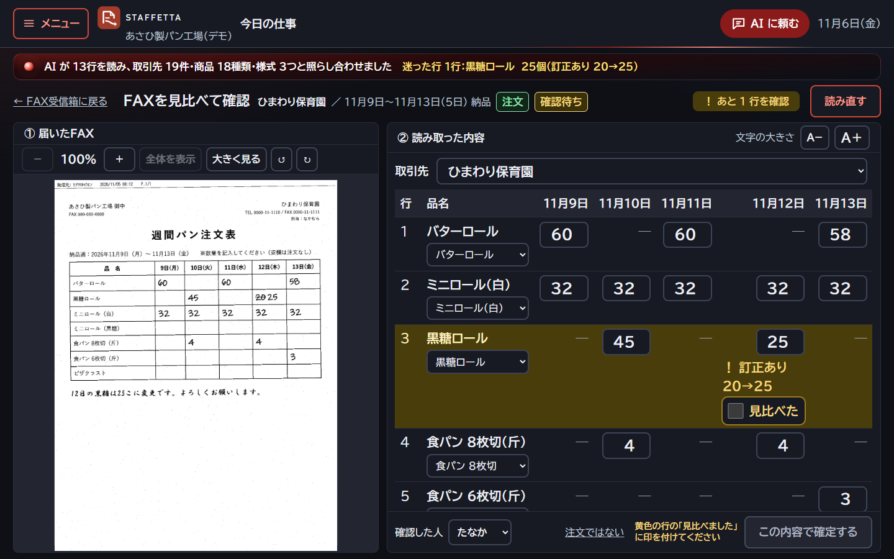</td>
    <td width="50%"><b>忘れていることを、急ぐ順に知らせる</b><br>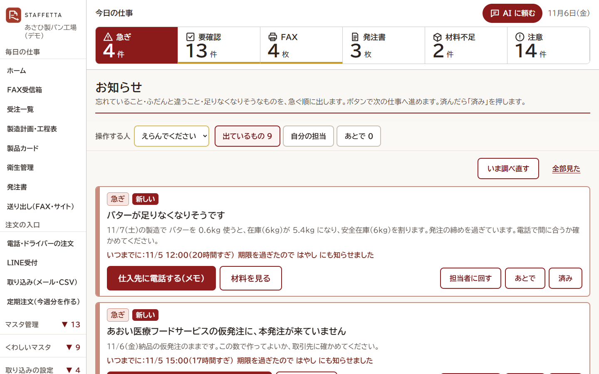</td>
  </tr>
  <tr>
    <td><b>作る数・始める時刻・人が足りるかを1画面で</b><br>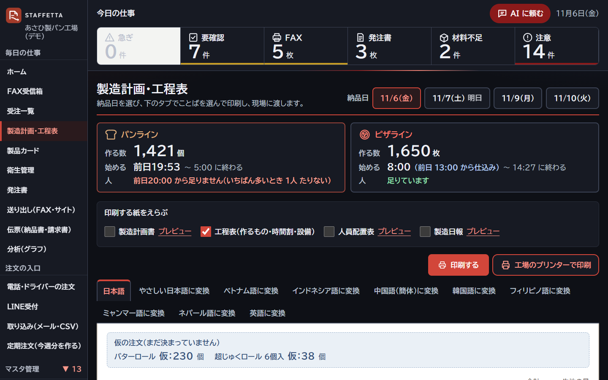</td>
    <td><b>自動にするか・人に聞くかを、ここで切り替える</b><br>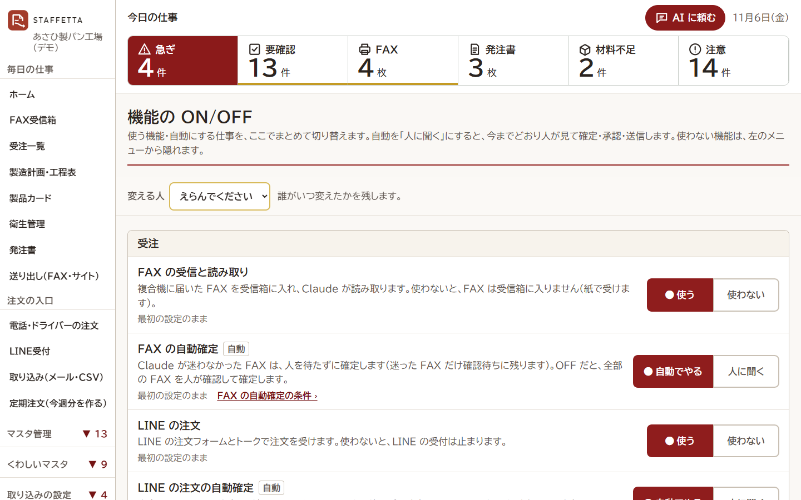</td>
  </tr>
  <tr>
    <td colspan="2"><b>お客さんは LINE で、届け日と数を押すだけ</b><br>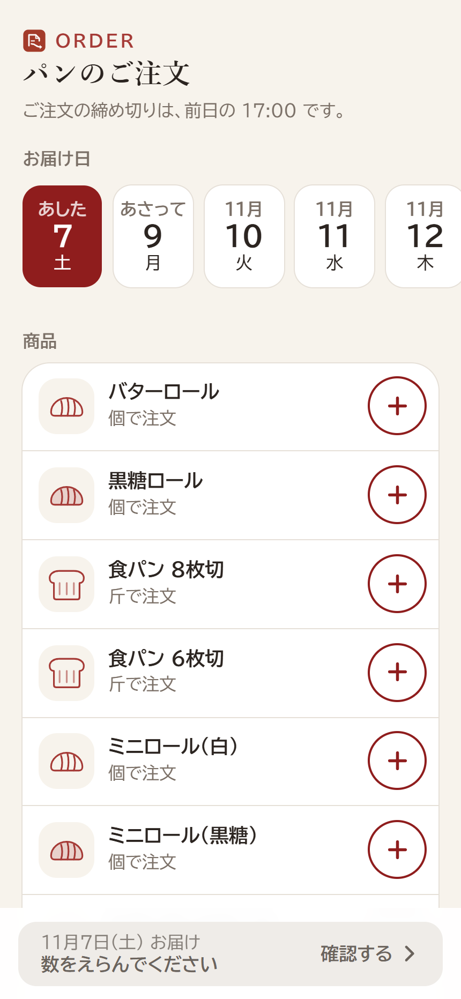</td>
  </tr>
</table>

写真は架空のデータ（あさひ製パン工場・デモ）で撮ったものです。

## 何を解決するか

愛知の中小のパン・ピザ工場では、注文の入口がばらばらです（FAX・メール・スプレッドシート・受発注サイト・電話・ドライバーの聞き取り）。
FAX は逆さまや横向きで届くこともあり、単位も「個・P・袋・ケース」がまざります。
いまは毎晩、課長が紙に書き写し、電卓で入数を換算し、仕入先ごとの発注をしています。
製造の現場も、その日になって生地の量と材料を計算し直しています。

STAFFETTAでは、Claude が注文を**読み取り**、あやしいところに**印を付け**ます。
人は大きなボタンとテンキーで、確かめて確定するだけです。
確定した注文からは、集計・入数の換算・発注書の下書き・製造計画・材料の発注が自動で出ます。
画面を使うのは、高齢の事務員さんと外国人スタッフです。そのため、少ない画面・大きな文字・紙に近い見た目・多言語にしています。

## 注文の入口と流れ

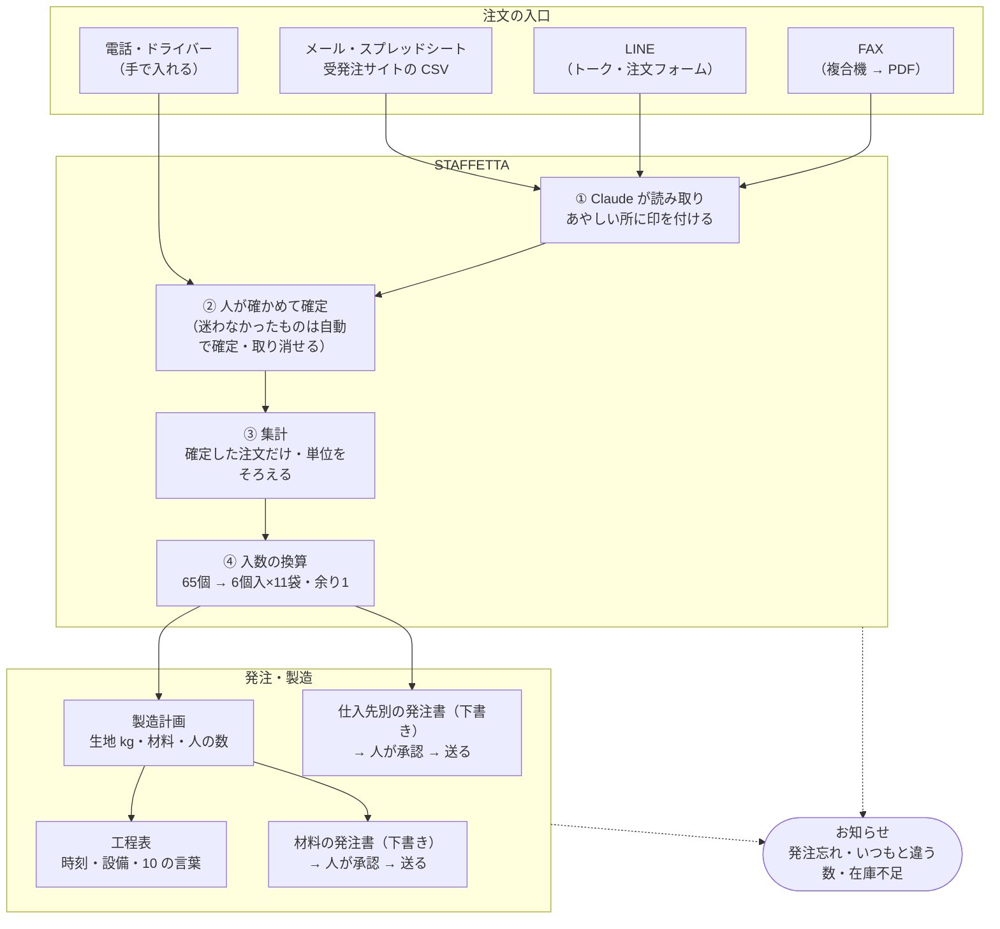

（GitHub では上の図がそのまま絵になります。同じ図の画像は [docs/screenshots/readme/flow.svg](docs/screenshots/readme/flow.svg)）

- 変更・キャンセルの連絡は、新しい注文（`intent: change / cancel`）として入れます。人が確定するまで、元の注文は書き換えません。
- 仮発注（概数で先に来て、当日に確定する注文）は集計に入れず、「仮：○個」として別枠で見せます。

## 画面

| 画面 | 内容 |
|---|---|
| `/` | FAX 受信箱。届いた FAX と、読み取りの状態（要確認の数）を見る |
| `/fax/[id]` | FAX の確認画面。元の FAX と読み取り結果を並べて表示し、テンキーで直して確定する |
| `/orders` | 受注一覧。すべての入口の注文を、納品日ごとに見る（要確認・仮発注・変更・取消の印つき） |
| `/plan` | 製造計画・工程表。パンとピザのライン別に、生地kg・工程の時刻・材料・上限の警告・原価を表示する |
| `/purchase` | 発注書。仕入先×便ごとの下書きを見て、承認する |
| `/import` | 外部の入口（メール・スプレッドシート・受発注サイトの CSV）から取り込む。取り込んだ注文は「要確認」で入る |
| `/outbound` | 承認した発注書の送り出し（受発注サイト・FAX・メール） |
| `/line` | LINE 受付（工場のスタッフ用）。はじめての LINE のお客さんを得意先にひも付け、確定の連絡と送信の記録を見る |
| `/liff/order` | お客さん用の LINE 注文フォーム（リッチメニューの「注文する」から開く） |

### 画面写真

架空のデータで、デモの日（2026-11-05 11:30）に合わせた時計で撮ったものです。タブレット横（1280×800）、LINE の注文フォームはスマホ（430×932）。
タブレット幅（1024）とスマホ幅（390）の全画面は [docs/screenshots/theme/](docs/screenshots/theme/) にあります。

**`/` FAX 受信箱** — 上の帯に「今日やること」（要確認・FAX・未送信の発注書と締め・注意）。主ボタンは「まとめて読み取る」の1つ
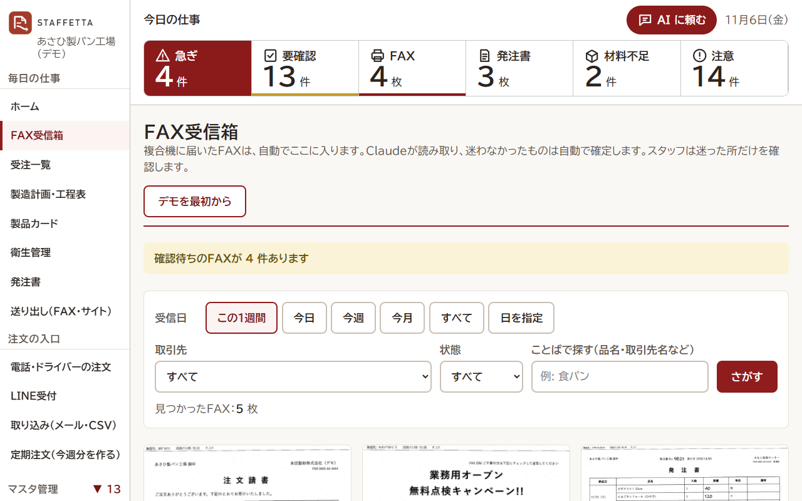

**`/fax/[id]` FAX の確認画面** — 左に元の FAX、右に読み取り結果。黄色の行を見比べて、数字をタップして直す
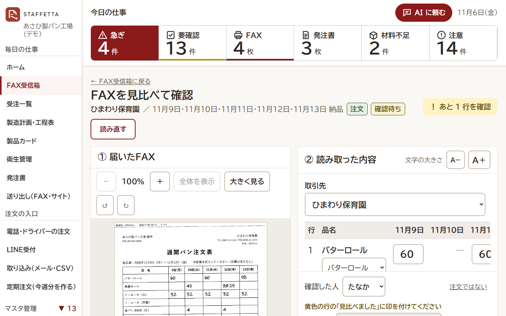

**`/orders` 受注一覧** — どの入口の注文も1つの一覧に。要確認がいちばん上。入口のアイコンと「元を見る」
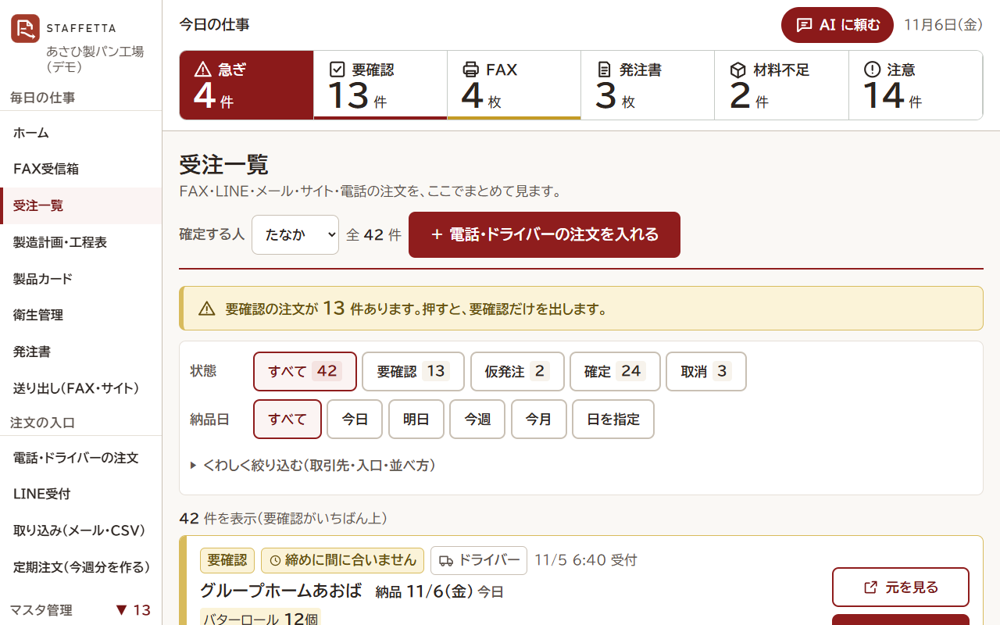

**`/plan` 製造計画・工程表（日本語）** — パンとピザのライン別に、作る数・生地 kg・時間割
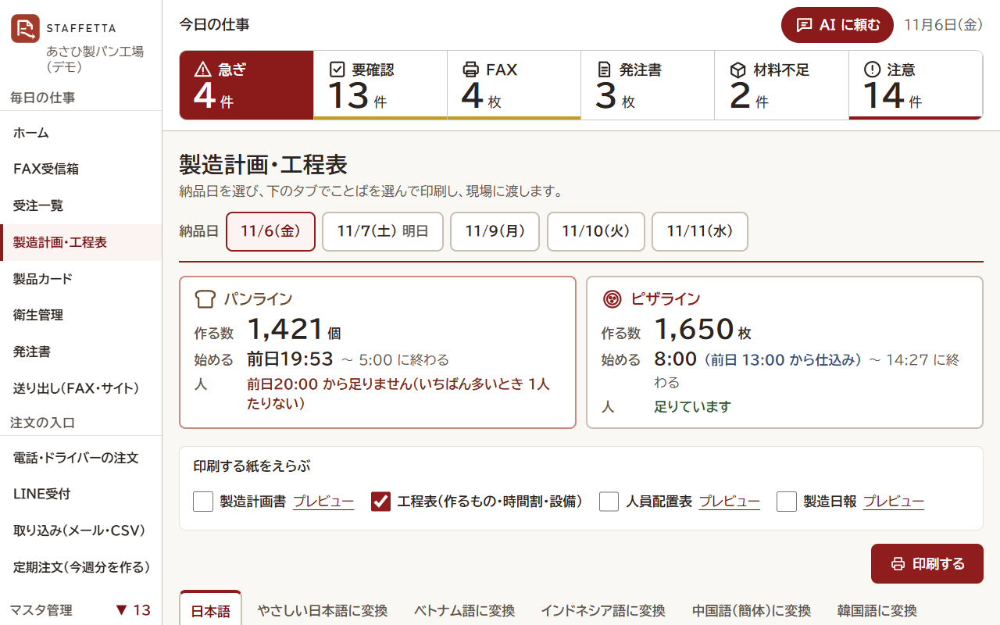

**`/plan` 製造計画・工程表（ベトナム語）** — 現場の言葉に1タップで切り替え。辞書に無い商品名は Claude が訳して「機械翻訳」の印
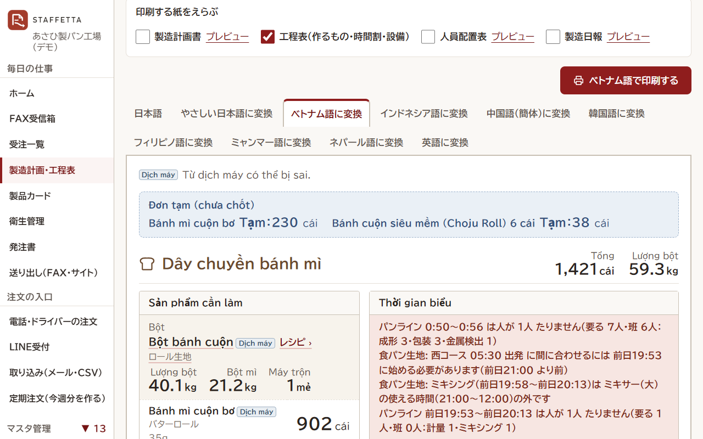

**`/purchase` 発注書** — 仕入先×便ごとの下書き。締めの早い順。承認してから送る
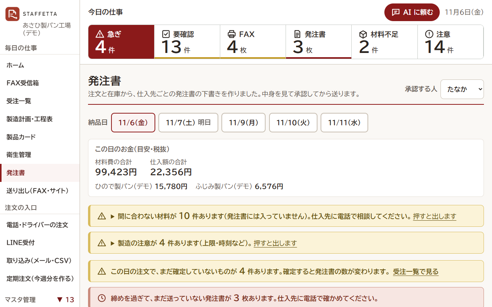

**`/liff/order` LINE の注文フォーム（お客さん用）** — 届け日と数を押すだけ
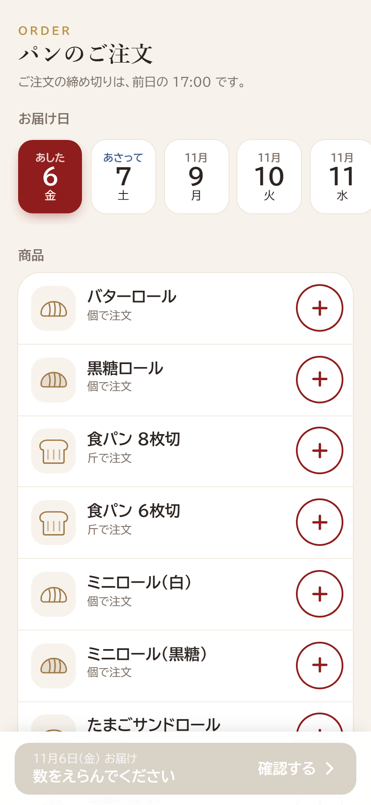

## 使い方の手引き

現場でそのまま使うための手引きです（やさしい日本語・画面の写真に番号つき・架空のデータ）。

- [スタッフ向けの操作の手引き](docs/manual/README.md) — 1日の流れ（朝：注文を確定 → 発注書を承認・送る → 夕方：製造計画を印刷）と、マスタの登録（CSV・1件ずつ・新しい商品のレシピと工程）
- [お客さん向け「LINE でのご注文のしかた」](docs/manual/customer-line-order.html)（A4 1枚・[PDF](docs/manual/customer-line-order.pdf)）
- [導入のしかた](docs/manual/setup.md) — マスタの CSV → FAX の転送 → LINE → 1週間ためて様式を承認

## 動かし方

Node.js 20.9 以上が必要です（動作確認は 24）。

```bash
npm install
```

`.env.example` を `.env.local` という名前でコピーし、次の項目に値を入れます。
空の項目があっても動きます。LINE が空ならデモモードになり、送らずに記録だけ残します。

| 項目 | 用途 |
|---|---|
| `ANTHROPIC_API_KEY` | Claude で FAX・メールなどを読み取る |
| `FAX_INBOUND_TOKEN` | Gmail（GAS）から FAX を受け取るときの合言葉 |
| `LINE_CHANNEL_SECRET` / `LINE_CHANNEL_ACCESS_TOKEN` | LINE 公式アカウント（Messaging API） |
| `LINE_LOGIN_CHANNEL_ID` / `NEXT_PUBLIC_LIFF_ID` | LINE の注文フォーム（LIFF） |

```bash
npm run dev -- -p 3100   # 開発サーバー（http://localhost:3100）
npm test                 # 計算のテスト（vitest）
npm run demo:reset       # デモを最初の状態に戻す（下の「デモのやり直し」）
npm run fax:simulate     # 「FAX が届いた」を再現する（変更 → 仮発注 → 本発注の FAX を1枚ずつ）
LINE_TEST_URL=http://localhost:3100/api/line/webhook node scripts/line-webhook-test.mjs "明日 ロール 20個"
                         # LINE の注文を再現する（LINE 未設定でも可）
```

`fax:simulate` と `line-webhook-test` は、開発サーバーが動いている状態で使います。
送り先は `fax:simulate` が `HUB_URL`（既定 `http://localhost:3100`）、`line-webhook-test` が `LINE_TEST_URL` です。
`fax:simulate` は `.env.local` の `FAX_INBOUND_TOKEN` を使います。

### デモのやり直し

```bash
npm run demo:reset
```

次の状態に戻ります。開発サーバーは止めなくてかまいません。

- 受信箱：FAX が F001〜F005（未読）
- 注文：あした 11/6（金）分などの、確定済みのデモ注文 DO-01〜DO-20
- 発注書：なし
- LINE：ひも付けなし・送信記録なし
- 受け取った FAX の PDF：なし

そのあと `npm run fax:simulate` を実行するたびに、次の FAX が1枚ずつ届きます。

接続の手順は `docs/` にあります（`line-setup.md`・`gmail-setup.md`・`google-sheet-auth.md`・`fax-sending.md`・`tunnel.md`）。

## 設計の決まり

- **AI がするのは「読み取り」と「要確認の印付け」まで。** 値を直すのも、確定するのも人です。人が確定した値を、AI が上書きすることはありません。
- **修正はタップとテンキー、＋−、候補から選ぶだけ。** キーボードで文字を打たなくても使えるようにしています。
- **元の値と修正の履歴を必ず残します。** AI が読んだ値（`read`）と、誰が・いつ・何を・何から何に直したか（`edits`）を保存します。
- **発注書は「下書き → 人が承認 → 送信」の順だけ。** 承認していない発注書は送れません。承認した人と時刻を記録します。承認済みの発注書は、計算し直しても上書きしません。
- **全社一律の締めは作りません。** 締めは商品ごとのリードタイムと、仕入先の便の締めから出します。
- **計算はふつうのプログラム（純関数）で行います。** 集計・入数換算・製造計画・材料・原価に AI は使わないので、同じ入力なら必ず同じ結果になります。テストも付けています。
- **ロス率などのマスターを、関数が勝手に書き換えることはありません。** 棚卸から出すのは「補正案」だけで、人が承認したものだけを使います。
- **パスワードや ID は AI が入力しません。** ログインが要る画面は人が操作します。

## フォルダ構成

```
src/
  app/                画面（Next.js App Router）と API
    api/fax/            FAX の受け取り（GAS から）
    api/line/           LINE の Webhook
    api/import/         外部の入口の取り込み
    api/outbound/       発注の送り出し
  components/         画面の部品（大きなボタン・テンキー・PDF 表示など）
  data/
    types.ts            共通の型（注文・発注書）
    master.ts           架空のマスター（得意先・仕入先・商品・材料）
    production.ts       架空の製造マスター（生地のレシピ・工程・入数・便・ライン）
    demo-orders.ts      デモ用の架空注文
  lib/                計算・保存・読み取り
    README.md           計算の関数の一覧（下記）
    store.ts            保存（data/db.json）
    fax-reader.ts       Claude による FAX の読み取り
    channels/           入口ごとの取り込み（line・email・google_sheet・infomart・kirara）と送り出し（outbound）
    aggregate.ts …      集計・入数換算・発注書・製造計画・材料・原価・締め・棚卸
  i18n/               多言語の文言
scripts/              FAX・LINE の再現、デモの初期化、見本の作成
public/samples/       見本の FAX・メール・CSV（すべて架空）
docs/                 接続の手順・使い方の手引き（docs/manual）
data/                 実行時のデータ（git には入れない）
```

## 主な計算

集計・入数換算・発注書・製造計画・工程表・材料の発注・原価・締めの判定・棚卸の関数と、その式は [src/lib/README.md](src/lib/README.md) にまとめています。

- 集計：確定の注文だけを、納品日・商品ごとに個数で合計します（個・P・袋・ケースをそろえる）。
- 入数換算：例えば 65個 → 6個入×11袋・余り1。食パンは「3斤を30枚に切り、1枚入り・2枚入りに包み直す」換算をします。
- 発注書：仕入先×便ごとに下書きを作ります。
- 製造計画：生地kg（ロス率込み・ベーカーズ％）、ミキサーの回数、ラインの上限（ピザ 1日1,800枚）の警告を出します。
- 工程表：パンは納品時刻から逆算し、ピザは前日の仕込みから組みます。
- 材料：3日先まで見て、在庫・リードタイム・最小ロットから発注書の下書きを作ります。
- 原価と粗利：材料費（ロス込み）と包材費・人件費、仕入品は実際に買う袋数で出します。

## Claude Code をどう使ったか

作者（工場の専務・エンジニアではない）が、**音声入力だけ**で Claude Code に指示を出して作りました。作者はコードを1行も書いていません。
作者が決めたのは「何に困っているか」「使う人はだれか」「どこまで自動にしてよいか」だけです。調べる・作る・確かめる・直すは Claude Code が行いました。
コードはすべてハッカソン期間中（11/2 以降）に作りました。前からあったのは、複合機の FAX を Gmail へ転送する設定だけです。前からある別の自動化（表計算のマクロなど）は、このリポジトリに含まれず、ハブからも使っていません。

### 1. 体制：担当ごとの並行セッション6つ＋管理役

| セッション | 受け持ち |
|---|---|
| 管理役 | 作者の指示を担当に分けて渡す。担当からの質問に答える。許可が要るものは作者に回す。テストを通してからマージ。見回り |
| ① 土台・FAX | データの型・SQLite、FAX の受信と読み取り、確認画面、名寄せの辞書、お知らせの保存 |
| ② 画面 | 画面の部品と見た目、工程表の印刷、10 の言葉、スマホ幅、お知らせ・機能の ON/OFF の画面 |
| ③ 計算 | 集計・入数の換算・発注書・製造計画・設備と人の制約・原価、ほかの担当の検証 |
| ④ LINE | LINE の注文フォームとトーク、取引先とのひも付け、スタッフへの通知 |
| ⑤ 外部サイト | メール・スプレッドシート・CSV の取り込み、発注の送り出し、マスタの CSV、自動化 |
| ⑥ 動画 | 構成・台本・音声・撮影 |

- 担当どうしは **セッション間のメッセージ** で直接相談します（例：②が「この部品の使い方」を①に教える、③の計算の形に②の画面を合わせる）。
- 作者への質問・許可（ログイン、本物の取引先への送信、公開など）は、管理役が1か所にまとめて作者に聞きます。作者は「はい／いいえ」と答えるだけです。

### 2. ぶつからない作り方：worktree とマージの手順

| 決まり | なぜ |
|---|---|
| 担当ごとに **git worktree（別のブランチ・別のフォルダ）** で作る | 同じファイルを同時に書き換えない |
| 担当はコミットだけ。push とマージは管理役 | master を壊さない |
| マージの前に、担当が master を取り込んで衝突を直し、`tsc` と `npm test` を通す | 衝突は、その中身を知っている担当が直す |
| 同じファイルを触るときは、先に担当どうしで一言かけ合う | 例：左メニューは①②④が触るので、足す前に知らせる |
| 本物のデータベースは触らない。確かめるときは **写し** か `HUB_DB_PATH=:memory:` | デモ用のデータを壊さない |
| 開発サーバーは確かめるときだけ起動して、すぐ止める | パソコンのメモリが足りなくなるため |

### 3. 機能の使い分け

| 機能 | どう使ったか |
|---|---|
| **並行セッション・メッセージ** | 上の体制。担当6つが同時に動き、直接やりとりした |
| **サブエージェント** | 作る前に、社内資料・過去のセッション・メール（読むだけ）を3つ同時に調べ、業務の全体像をまとめた。④は、ほかの LINE 注文の画面の調べものを任せた |
| **Skills** | `claude-api` スキルを読んでから、アプリの中で Claude を呼ぶコード（FAX・LINE の読み取り、10 の言葉への訳）を書いた |
| **MCP（ブラウザ）** | アプリ内のブラウザで、作った画面をタブレット幅・スマホ幅・印刷の幅で開いて確かめた。Chrome では、LINE やサイトの設定画面を「開いて、入力するだけ」の所まで進め、ログインとパスワードは作者が入れた |
| **MCP（メール）** | 業務の調べものと、運営からの連絡を読むのに使った（読むだけ） |
| **定期の見回り** | 管理役が 30 分おきに、止まっている担当・マージ待ちのブランチ・サーバーが動いているかを確かめた |

### 4. 試して、まちがえて、直した例

| 例 | 何が起きたか | どう直したか |
|---|---|---|
| **FAX の黄色が多すぎた** | 架空の FAX 39 行の読み取りは全部正しかったのに、67% の行に「念のため見る」の黄色が付いていた。指示文の「1と7、0と6に注意」が、全部の行の注意の文に写っていた | 「注意の文は、FAX を見て確かめないと危ない行だけ。説明はメモへ」と、例つきで指示文を書き直した。黄色は約 10%（39 行中 4 行。訂正・丸の選択など）に減り、正しさは 39/39 のまま |
| **/line だけエラーの画面になった** | `"use client"` の部品のファイルにある普通の関数を、サーバーの画面から呼んでいた。`tsc` もテストも通るので、ページを開くまで気づけなかった（同じ形は /plan でも1回起きていた） | 関数を普通のファイル（`src/lib/auto-confirmed.ts`）に移した。それからは「入れ替えたら全ページを開き、中身の文字とエラーが無いことまで見る」を毎回行う。同じ形がほかに無いかも、全体を機械で調べた。決まりとして「クライアントのファイルからは、サーバーで使う関数を出さない」 |
| **データベースの取引先の名前を入れ替えた** | 公開の前の点検で、プログラムの英語の名前に実在の社名が残っていた。名前を変えるだけだと、前に作ったデータベースの中の古い名前が残る | データベースを開いたときに1回だけ、全部の表の文字を新しい架空の名前に書き換える仕組みを作った（済みの印つき）。データベースの写しで試して、47 か所 → 0、2回目は何もしないことを確かめてから入れた（古い名前はソースにも書かない） |

### 5. アプリの中の Claude と、人の役目

- **アプリの中の Claude**：FAX の画像・LINE のトーク・メールの PDF や Excel を読み取り、あやしい所に印を付けます。取引先ごとの呼び名の辞書と、人が直した例を、次の読み取りに添えます。現場の 10 の言葉にも訳します。
- **人が最後に決める**：AI は値を書き換えません。迷わなかったものだけ自動で確定し、「自動」の札が付いて、いつでも取り消せます。発注は、人が承認しないと送りません。

くわしくは [docs/dev-log/](docs/dev-log/) の作業記録（00 管理役、01〜05 各担当）にあります。
