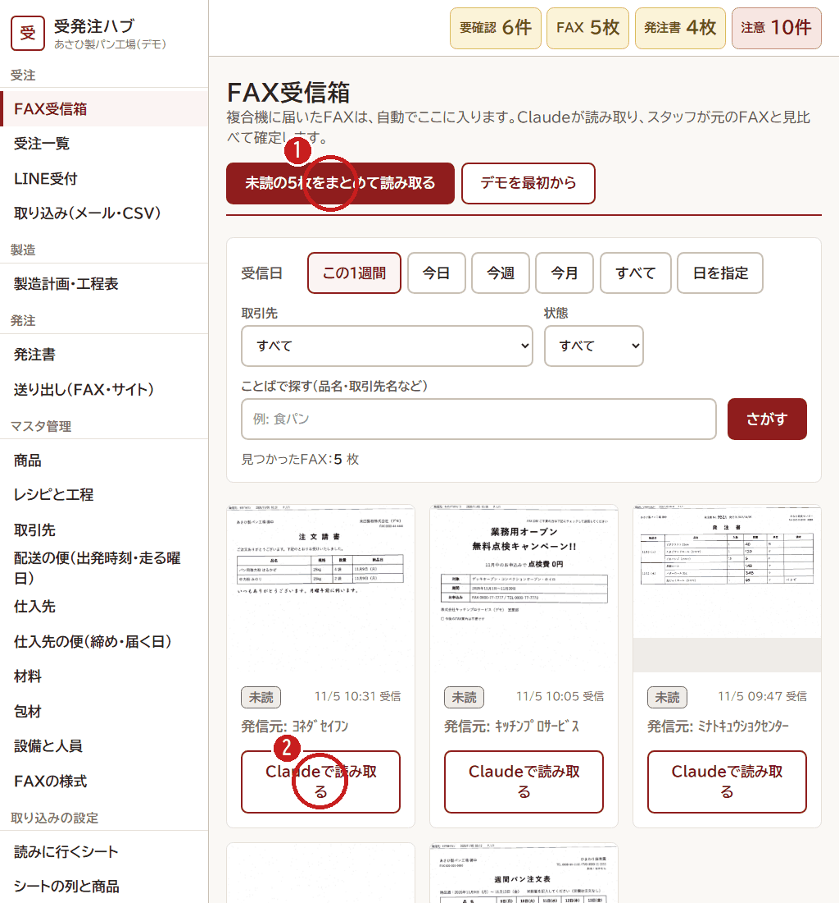
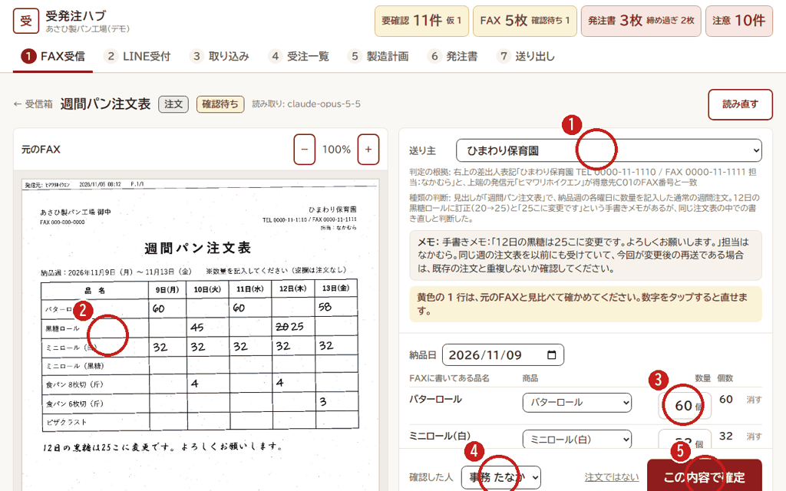

# 1. FAX を確定する（朝）

[← 目次](README.md)

複合機に届いた FAX は、自動で **FAX受信箱** に入ります。Claude が読み取るので、人は **元の FAX と見くらべて** 確定します。

## FAX受信箱

1. **「未読の○枚をまとめて読み取る」** を押します。1枚ずつ読むときは ② を押します。
2. 読み取りがおわった FAX を押すと、確認の画面が開きます。

## 見くらべて確定する

1. **送り主（お店）** が合っているか見ます。ちがうときは、えらび直します。
2. 左の **元の FAX** を見ます。小さいときは「＋」で大きくできます。
3. 右の **数** を、元の FAX と1行ずつ見くらべます。**黄色の行** は、Claude が「見てください」と言っている行です。数字を押すと、テンキーで直せます。
4. **確認した人**（自分の名前）をえらびます。
5. **「この内容で確定」** を押します。

## こんなときは

| こんなとき | すること |
|---|---|
| 広告・注文ではない FAX | 「注文ではない」を押します |
| はじめて来た様式の FAX | 「新しい様式・承認待ち」と出ます。内容が正しければ様式を承認します。次からは自動で読み取ります |
| 「変更」「取消」の FAX | 元の注文と、変わった数がならんで出ます。見くらべて「この変更を反映する」を押します |
| 読み取りがおかしい | 右上の「読み直す」を押します |
