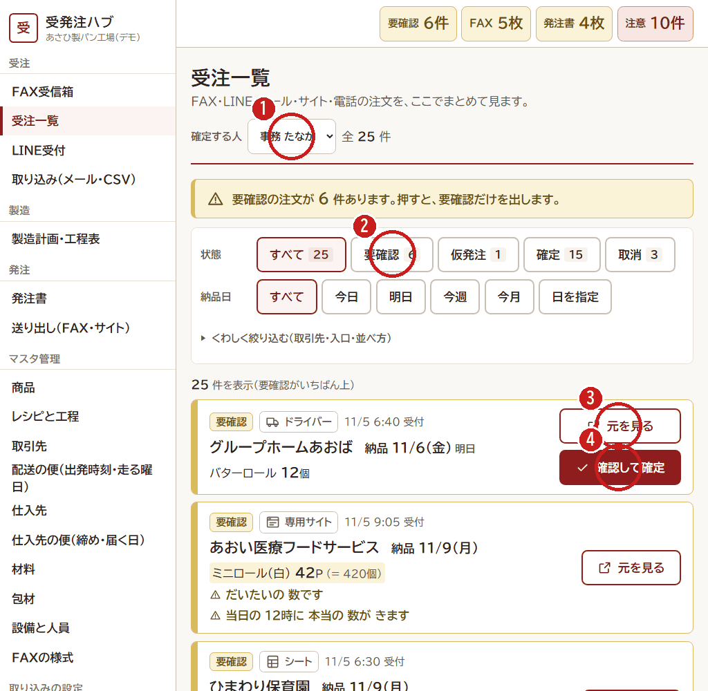

# 2. 受注一覧で確定する（朝）

[← 目次](README.md)

FAX・LINE・メール・取引先のサイト・電話・ドライバーの聞き取り。どこから来た注文も、**受注一覧** にまとめて出ます。
いちばん上に **要確認**（黄色）の注文がならびます。

1. **確定する人**（自分の名前）をえらびます。
2. **「要確認」** を押すと、まだ確定していない注文だけが出ます。
3. **「元を見る」** で、元の FAX・LINE の文・メールを見ます。
4. 合っていれば **「確認して確定」** を押します。直すところがあれば、開いた画面で数を直してから確定します。

## 黄色の文の読みかた

注文の下の **⚠ の文** は、Claude や取り込みの係が「ここを見てください」と書いたものです。

| 文の例 | 意味 |
|---|---|
| だいたいの 数です | 仮の数です（仮発注）。当日に本当の数が来ます |
| 「いつもの」が 何か 分かりません | 品名が書いてありません。前の注文やお店に聞いて決めます |
| ○○は 11/5 11:00 が締めでした | 締め切りのあとに来た注文です。間に合うか、現場・仕入先に聞いてください |
| △△は日曜日に納品していません | 納品しない曜日の注文です。お店に日を聞いてください |

- **黄色** は「締め切りのあと」、**うすい黄色** は「仮発注なので、確定の数を早めに聞く」です。
- 確定すると、製造計画と発注書の数が、すぐに変わります。
