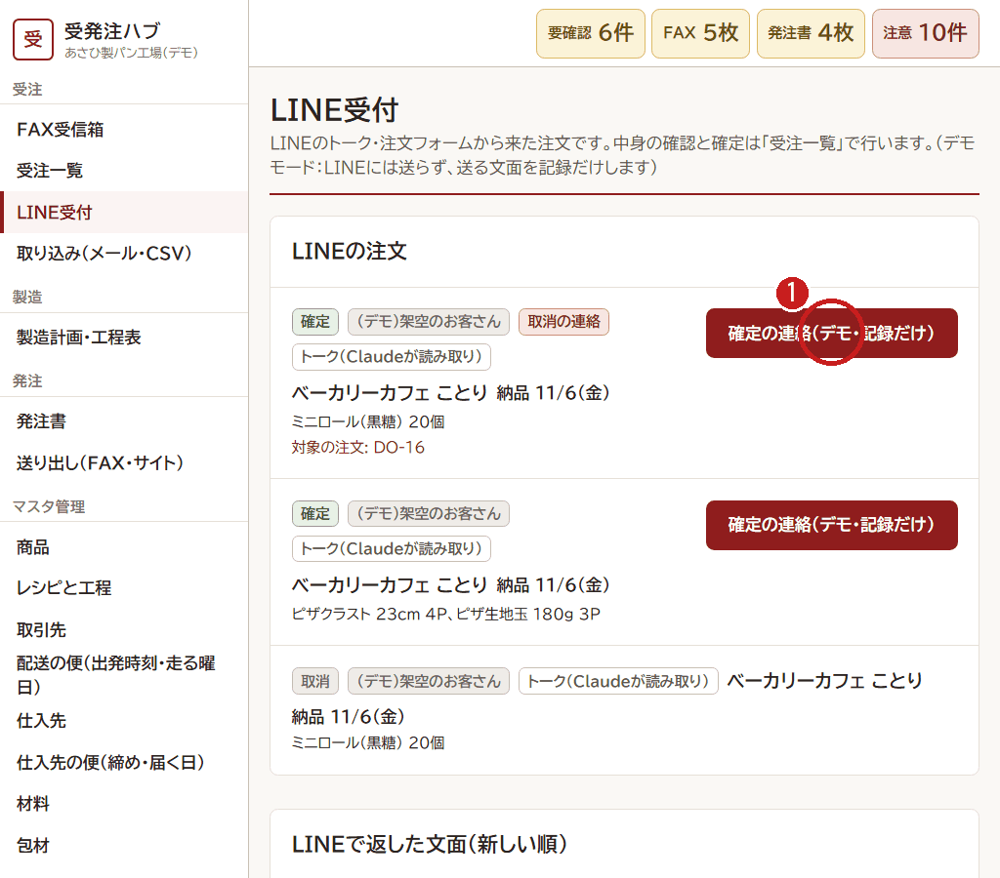

# 3. LINE の確定の連絡（朝）

[← 目次](README.md)

LINE で来た注文を受注一覧で確定したら、お客さんに **「ご注文を確定しました」** を送ります。
**自動では送りません。** 人がボタンを押したときだけ送ります。

1. 確定した注文の **「確定の連絡」** を押します。送る文が出るので、読んでから送ります。
   - 送ったあとは「確定の連絡ずみ」になります。2回は送りません。
   - 架空のお客さん（デモ）には、LINE に送らず、記録だけします。

## LINE受付の画面で見られること

- お客さんの **トークの文**（Claude が読み取った元の文）
- 注文フォームから来たか、トークから来たか
- 商品ごとの **締めの判定**（締めのあとなら黄色、仮発注ならうすい黄色）
- いちばん下に、LINE で返した文の記録

## はじめての LINE の人

「どのお店か分からない LINE の人がいます」と出たら、**取引先** の画面で、その人をお店にひも付けます（1回だけ）。
2回目からは、自動でそのお店の注文になります。
