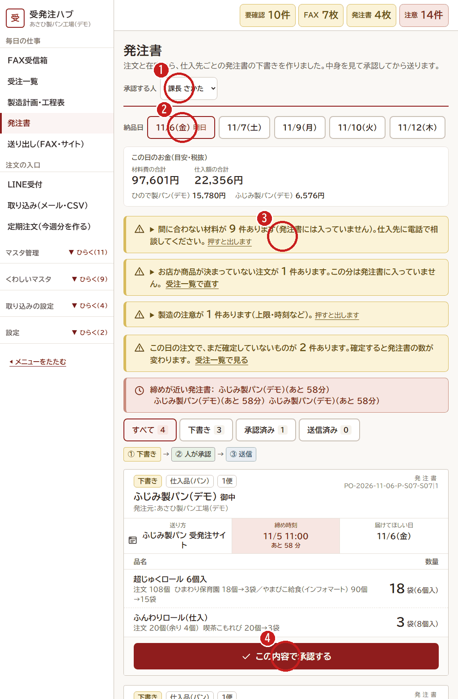

# 4. 発注書を承認する（昼まで）

[← 目次](README.md)

確定した注文と在庫から、**仕入先ごとの発注書の下書き** が自動でできます。
人が中身を見て **承認** します。承認するまで、発注書は送られません。

1. **承認する人**（自分の名前）をえらびます。
2. **納品日** をえらびます。「明日」がいちばん左です。
3. **黄色・赤の注意** を先に読みます。
   - 「間に合わない材料があります」→ 仕入先に電話で相談します（発注書には入っていません）
   - 「まだ確定していない注文があります」→ 先に受注一覧で確定します。確定すると発注書の数が変わります
   - 「締めが近い発注書」→ あと何分で仕入先の締めかが出ます。先にこれを承認します
4. 品名と数を見て、よければ **「この内容で承認する」** を押します。

- 発注書の流れ：**① 下書き → ② 人が承認 → ③ 送信**
- 数の下の小さい字は、その数の内わけ（どのお店の注文から来たか）です。
