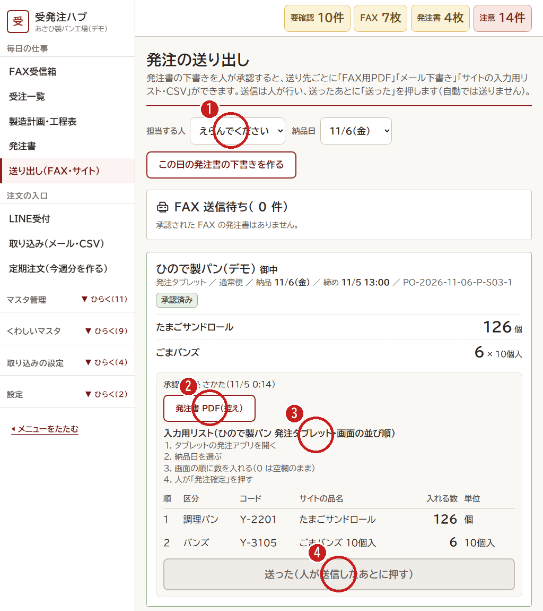

# 5. 発注書を送る（昼まで）

[← 目次](README.md)

承認した発注書を、仕入先に送ります。送り方は仕入先ごとに決まっています（FAX・メール・仕入先のサイト）。
**送るのは人です。** ハブは、送るための紙・文・入力用のリストを作るだけです。

1. **担当する人**（自分の名前）と **納品日** をえらびます。
2. FAX の仕入先は **「発注書 PDF」** を開いて、複合機から FAX します。
3. サイトで注文する仕入先は **入力用リスト** を見ながら、仕入先のサイトに数を入れます。リストは、サイトの画面と同じ順にならんでいます。
4. 送りおわったら **「送った」** を押します。押さないと「送信待ち」のまま残ります。

- メールの仕入先は「メール下書き」ができます。中身を見てから、自分で送ります。
- 送ったあとで数を変えたいときは、仕入先に電話してから、発注書を直します。
