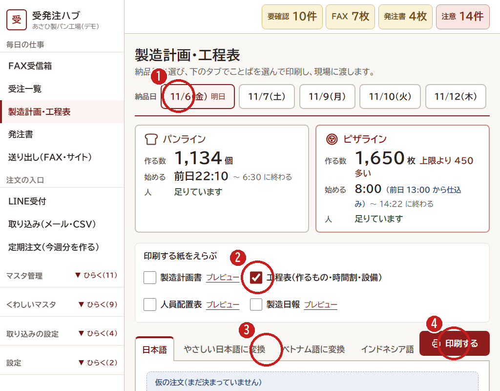

# 6. 製造計画を印刷する（夕方）

[← 目次](README.md)

確定した注文から、**明日なにを・いくつ・何時から作るか** が自動で計算されます。
夕方に印刷して、現場にわたします。

1. **納品日** をえらびます。上の箱に、ラインごとの作る数・始める時刻・人が足りるかが出ます。
2. **印刷する紙** にチェックを入れます。
   - 製造計画書：作る数と生地の量
   - 工程表：作るもの・時間わり・設備
   - 人員配置表：だれがどの工程か
   - 製造日報：現場が書きこむ紙
3. **ことば** をえらびます。やさしい日本語・ベトナム語・インドネシア語にできます。
4. **「印刷する」** を押します。

- 「上限より ○○ 多い」と赤く出たら、その日はラインの上限をこえています。早く始めるか、別の日にするかを、製造の責任者と決めます。
- 「仮の注文（まだ決まっていません）」は、仮発注の数で計算しています。当日に数が来たら、受注一覧で確定します。
