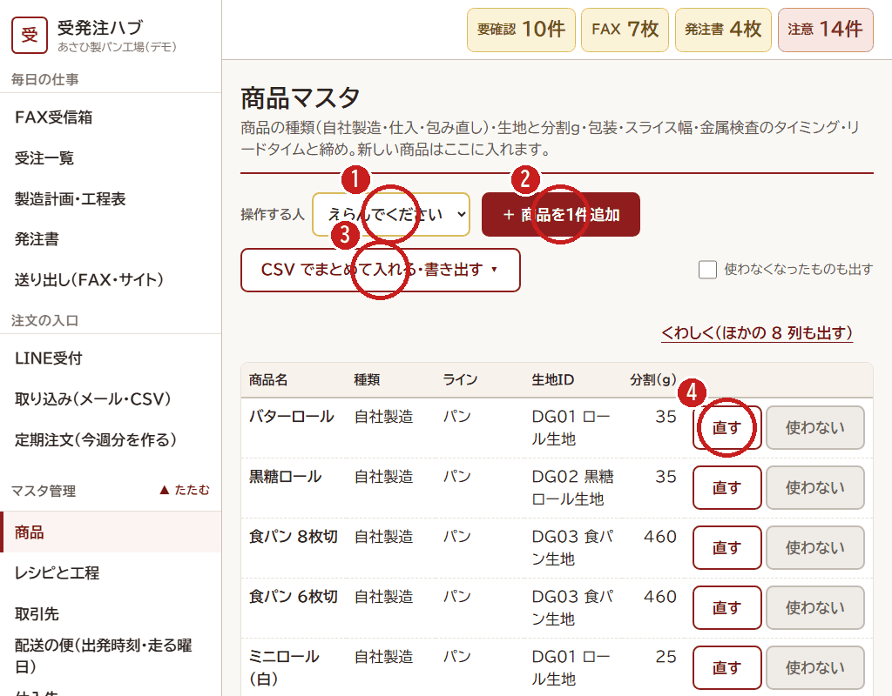

# 7. マスタを CSV で一括登録する

[← 目次](README.md)

商品・取引先・仕入先・材料などを、**Excel で作った CSV** でまとめて入れられます。
どのマスタも、やり方は同じです。（写真は商品のマスタ）

1. **操作する人**（自分の名前）をえらびます。
2. （1件だけ足すときは「＋ ○○を1件追加」。[8. 1件ずつ登録](08-master-one.md)）
3. **「CSV でまとめて入れる・書き出す ▾」** を押すと、3つのボタンが出ます。

| ボタン | 使うとき |
|---|---|
| 空のテンプレート（見出しだけ） | はじめて入れるとき。見出しだけの CSV ができるので、Excel で1行に1件ずつ書きます |
| いまの中身を CSV に書き出す | まとめて直すとき。書き出した CSV を Excel で直して、また読み込みます |
| CSV を読み込む（登録の前に確認します） | 作った CSV を入れるとき |

## 読み込んだあと（確認の画面）

CSV を読み込むと、**すぐには登録しません。** 先に、1行ずつ結果が出ます。

- **追加**：新しく入る行
- **更新**：今ある行が変わる。「前 → 後」が出ます
- **変化なし**：同じ内容
- **エラー**：入れられない行。何行目の、どの列がだめかが出ます

エラーが **1つでも** あると登録できません。Excel で直して、もう一度読み込みます。
エラーがなければ **「この内容で登録する」** を押します。やめるときは「やめて一覧にもどる」。だれが・いつ・何を変えたかは、記録にのこります。

## CSV を作るときの注意

- 文字コードは **Shift_JIS（Excel のふつうの保存）でも UTF-8 でも** 読めます。
- **ID の列** が同じ行は「更新」、新しい ID は「追加」になります。ID が空なら自動で番号をふります。
- CSV に無い列は、今の値のままです（消えません）。
- 消したいときは CSV から行を消すのではなく、画面の「使わない」を押します。
