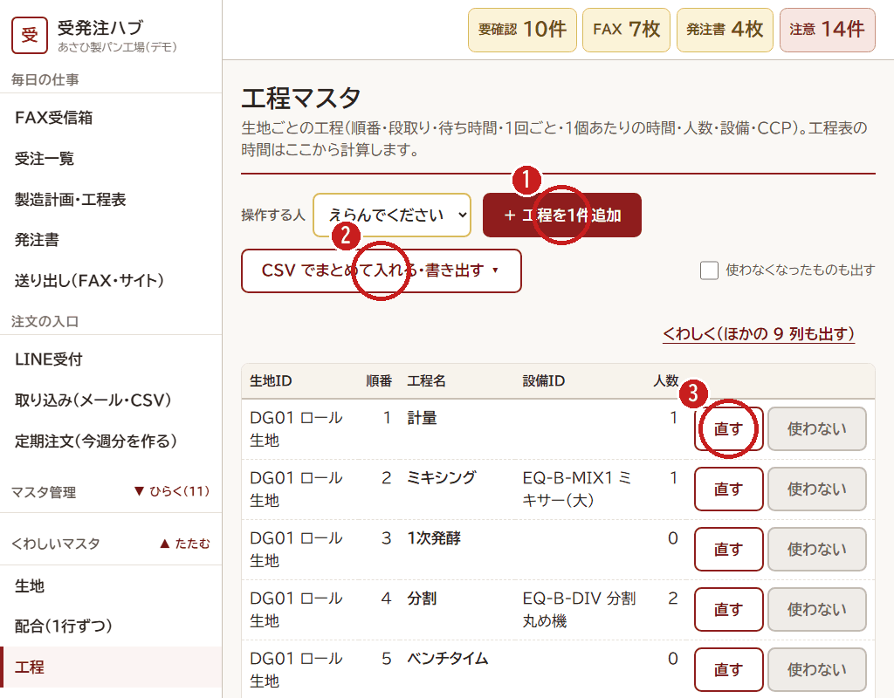
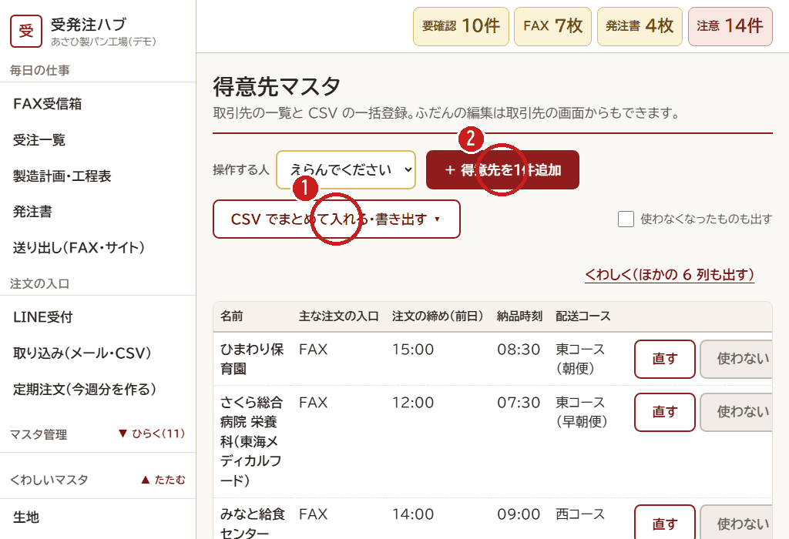

# 8. マスタを1件ずつ登録する

[← 目次](README.md)

1件だけ足す・直すときは、画面で入れます。（写真は工程のマスタ）

1. **「＋ ○○を1件追加」** を押します（その前に **操作する人** をえらびます）。
2. （たくさん入れるときは [7. CSV で一括登録](07-master-csv.md)）
3. 直すときは、その行の **「直す」** を押します。

入力の画面では、

- **（必ず入れる）** と書いてある所は、空にできません。
- 時刻は `15:00` のように、数は半角で入れます。まちがっていると、赤い字で理由が出ます。
- 画面の下の **「保存する」** を押すまで、登録されません。

## 使わなくなったとき

行の **「使わない」** を押します。消えるのではなく、一覧から見えなくなるだけです。
上の「使わなくなったものも出す」にチェックを入れると、また出せます（もとに戻せます）。

## 取引先

取引先は、2つの画面があります。

1. **CSV で一括** のとき：くわしいマスタの「取引先（CSV で一括）」
2. **1件ずつ・LINE のひも付け** のとき：マスタ管理の「取引先」

取引先には、**注文の締め（前日の何時まで）・納品時刻・配送コース** を入れます。
ここの締めと、配送コースの走る曜日で、「締めのあと」「納品しない曜日」の黄色の表示が決まります。
