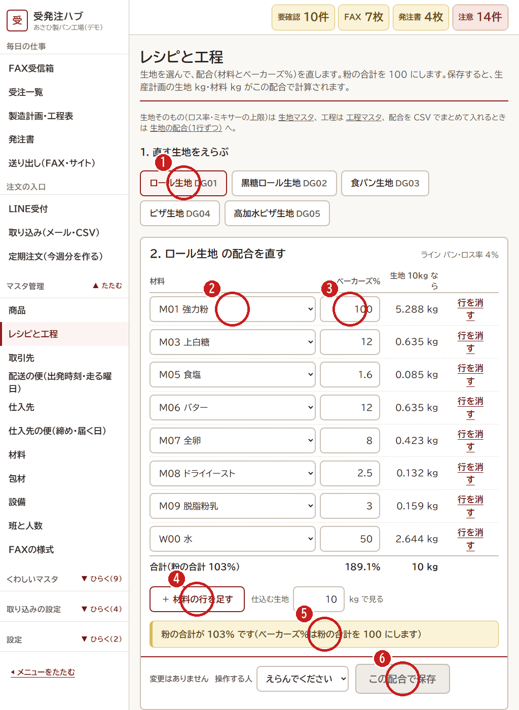

# 9. 新しい商品を作る（レシピと工程）

[← 目次](README.md)

新しいパンを売りはじめるときは、**生地 → 配合 → 工程 → 商品** の順に入れます。
今ある生地で作る商品なら、4. の「商品」だけで大丈夫です。

| 順番 | 画面（左のメニュー） | 入れること |
|---|---|---|
| 1 | くわしいマスタ → **生地** | 生地の名前・ライン（パン／ピザ）・ロス率・ミキサー1回の上限 |
| 2 | マスタ管理 → **レシピと工程** | 配合（材料とベーカーズ％）。下の写真 |
| 3 | くわしいマスタ → **工程** | 計量・ミキシング・発酵・分割・焼成…の順番、使う設備、人数、時間 |
| 4 | マスタ管理 → **商品** | 商品名・種類（自社製造／仕入）・生地・分割のグラム・数え方・売価 |
| 5 | くわしいマスタ → **商品の包材** | 1個に使う袋・シールなど |

材料が新しいときは、先に **材料** のマスタに入れます（仕入先も決めておきます）。

## 配合を入れる（レシピと工程）

1. **直す生地** をえらびます。
2. **材料** をえらびます。
3. **ベーカーズ％** を入れます（粉を 100 とした％）。右に「生地 10kg なら何 kg」が出ます。
4. 材料をふやすときは **「＋ 材料の行を足す」**。
5. 黄色の文が出たら読みます。**粉の合計は 100** にします。
6. **操作する人** をえらんで **「この配合で保存」** を押します。

保存すると、製造計画の生地の量・材料の量が、この配合で計算されます。

## 工程を入れる

工程は [8. 1件ずつ登録](08-master-one.md) と同じやり方です。生地ごとに、**順番** の数字で並びます。
設備（ミキサー・オーブンなど）をえらぶと、工程表で設備が重ならないように時間がずれます。
