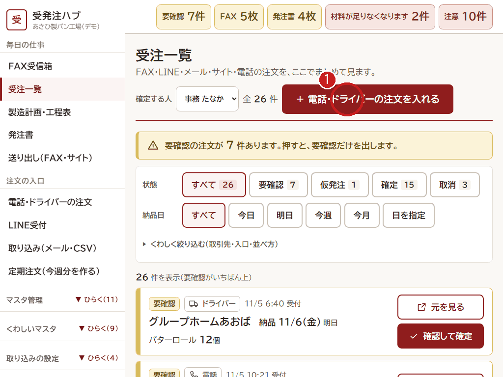
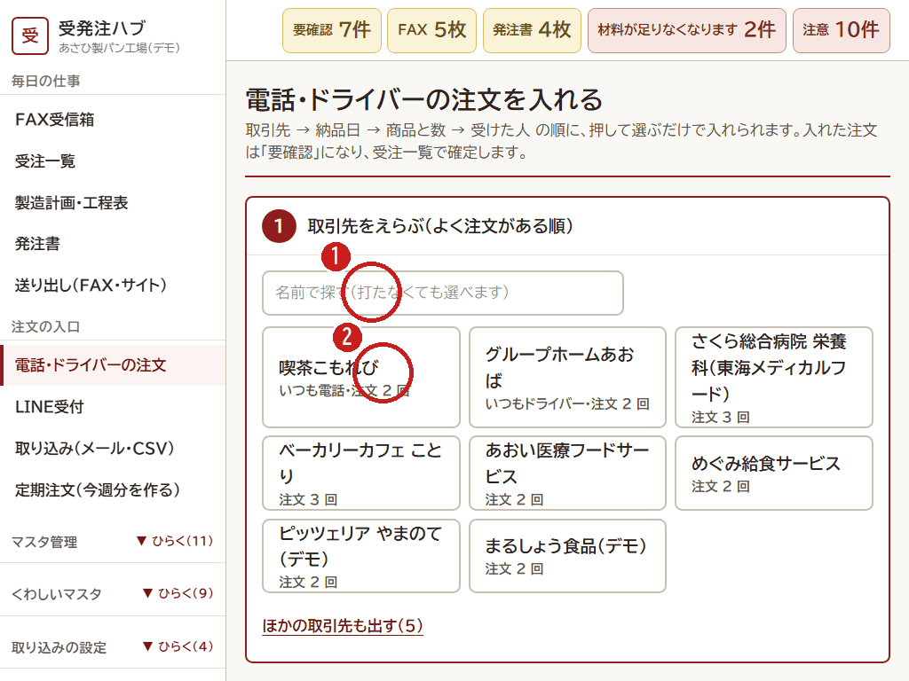
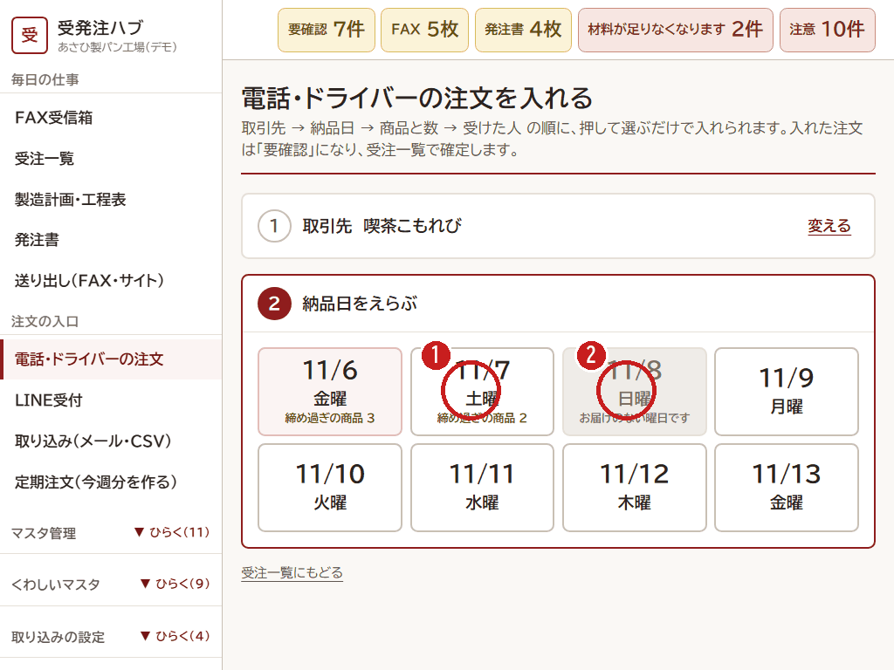
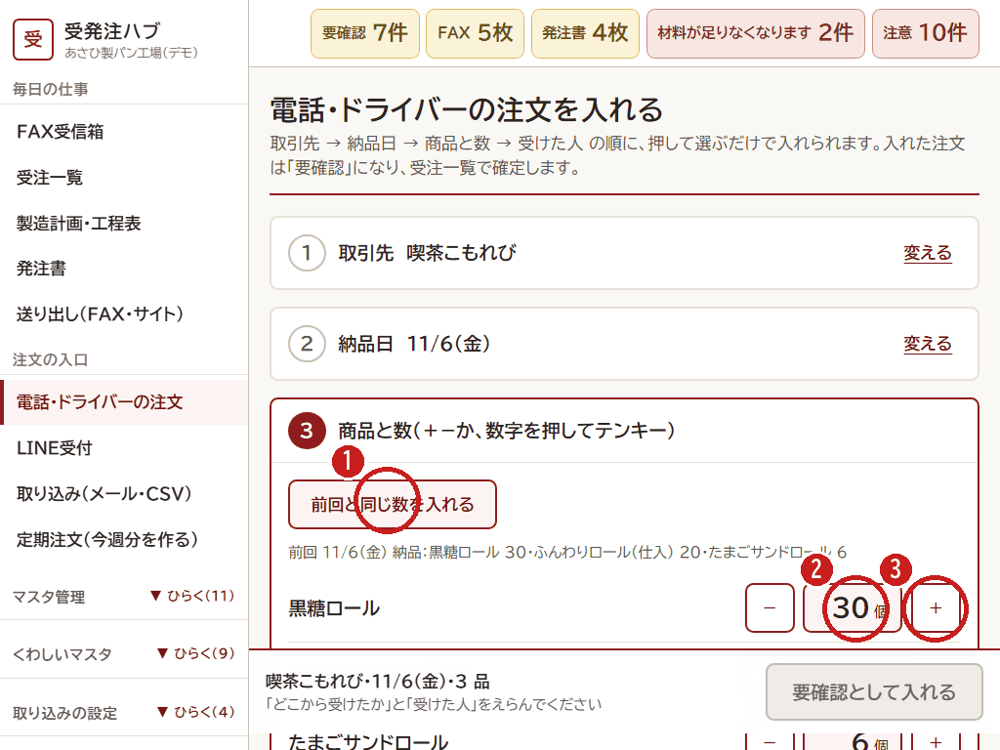
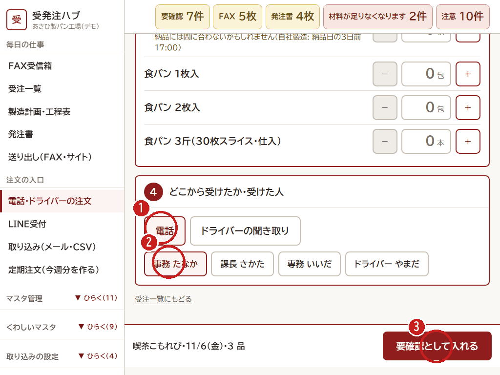
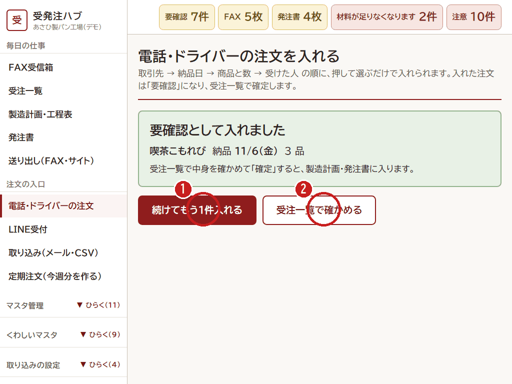

# 電話・ドライバーの注文を入れる

[← 目次](README.md)

電話で受けた注文や、ドライバーが納品先で聞いてきた注文は、画面で入れます。
**押して選ぶだけ** で入れられます。入れた注文は **要確認** になり、あとで受注一覧で確定します。

順番は **取引先 → 納品日 → 商品と数 → 受けた人** です。

## 入れる画面を開く

1. 受注一覧の上の **「＋ 電話・ドライバーの注文を入れる」** を押します。左のメニューの「電話・ドライバーの注文」からも開けます。

## 1. 取引先をえらぶ

1. 名前で探すときは、ここに打ちます（打たなくても選べます）。
2. お店を押します。よく注文があるお店ほど、上に出ます。見つからないときは「ほかの取引先も出す」。

## 2. 納品日をえらぶ

1. 日付を押します。「締め過ぎの商品 ○」は、その日にはもう間に合わない商品の数です。
2. **灰色の日** は、そのお店に届けない曜日です。押せません。

## 3. 商品と数を入れる

1. いつもと同じなら **「前回と同じ数を入れる」**。前回の中身が下に出ています。
2. 数字を押すと、テンキーでまとめて入れられます。
3. 「＋」「−」で1つずつ変えます。締めに間に合わない商品は、その場で黄色の文が出ます。

## 4. どこから受けたか・受けた人

1. **「電話」** か **「ドライバーの聞き取り」** を押します。
2. **受けた人**（自分の名前）を押します。
3. 下の **「要確認として入れる」** を押します。

## 入れたあと

1. 続けて入れるときは **「続けてもう1件入れる」**。
2. **「受注一覧で確かめる」** を押して、[2. 受注一覧で確定する](02-orders.md) と同じように確定します。確定すると、製造計画と発注書に入ります。

- 電話で聞きまちがえやすい数は、お客さんに **読み上げて** 確かめてから入れます。
